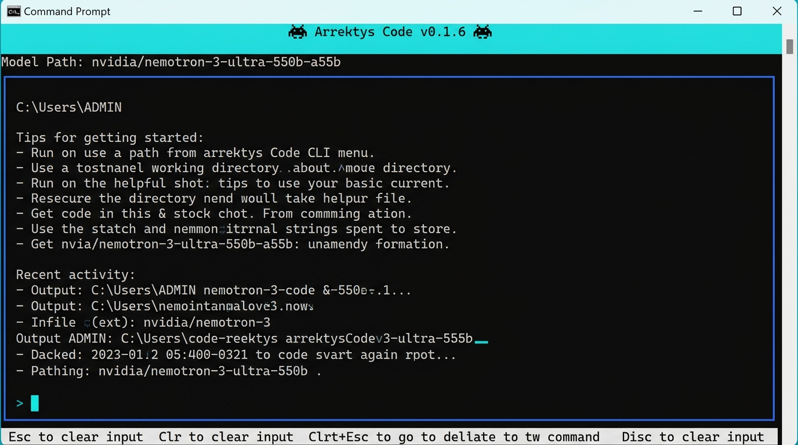

# VERTEX

<p align="center">
  
</p>

<p align="center">
  <strong>An agentic, terminal-native cybersecurity assistant for software engineering, system auditing, and threat response.</strong>
</p>

<p align="center">
  <a href="#installation">Installation</a> •
  <a href="#quickstart">Quickstart</a> •
  <a href="#core-capabilities">Capabilities</a> •
  <a href="#agent-architecture">Architecture</a> •
  <a href="#security--sandbox">Security</a> •
  <a href="#slash-commands">Commands</a>
</p>

---

VERTEX is a powerful AI coding and security assistant that operates directly in your terminal. It understands your codebase, audits Linux system surfaces, executes untrusted code in isolated sandboxes, and automates multi-step development and cybersecurity tasks using natural language.

Built on an agentic multi-agent architecture, VERTEX routes requests to specialized autonomous subagents—from security auditing and web reconnaissance to reverse engineering and code generation.

## Features

- 🤖 **Agentic Multi-Agent System**: Automatically routes tasks to specialized agents (`CyberAgent`, `DeveloperAgent`, `ReconAgent`, `SentinelAgent`, `PhantomAgent`, `BrowserAgent`).
- 🛡️ **Hardened Docker Sandbox**: Run untrusted commands, malware research, or containerized checks in ephemeral Alpine Linux containers with zero network access and strict resource limits.
- 🔍 **Integrated Security Audit Suite**: Built-in system tools for secret scanning (`env_secrets_scan`), process analysis (`process_inspect`), file integrity manifests (`file_integrity`), and network surface mapping (`port_scan`, `network_audit`).
- ⚡ **Terminal-Native TTY Interface**: Reactive Ink interface built for speed, real-time status telemetry, autocomplete slash commands, and seamless workspace awareness.
- 🌐 **Web Reconnaissance & Browser Agent**: Puppeteer-driven browser navigation, screenshot generation, and URL text summarization.
- 🔌 **Extensible Plugin Framework**: Integrated connectors (GitHub, Slack), devtools, workflow automation, and custom tool suites.

---

## Installation

### Prerequisites

- **Node.js**: v20.x or higher (v22+ recommended)
- **Git**
- **Docker** *(Optional, recommended for sandboxed execution)*

### Installation Script

#### macOS / Linux
```bash
git clone https://github.com/vimalspaceton618-afk/vertex.git
cd vertex
npm install
npm run build
npm link
```

#### Windows (PowerShell)
```powershell
git clone https://github.com/vimalspaceton618-afk/vertex.git
cd vertex
npm install
npm run build
npm link
```

Once linked, run `vertex` from any directory in your terminal.

---

## Quickstart

### 1. Set up Environment Variables

Create a `.env` file in your project directory:

```bash
cp .env.example .env
```

Configure your API keys:
```env
OPENAI_API_KEY=your_llm_api_key
OPENAI_BASE_URL=https://openrouter.ai/api/v1
AI_MODEL=google/gemma-4-26b-a4b-it:free
```

### 2. Start VERTEX

Launch an interactive session inside your project workspace:

```bash
vertex
```

---

## Core Capabilities

### Natural Language Security Operations

VERTEX accepts natural language prompts to perform end-to-end security and engineering workflows:

- *"Audit this codebase for exposed secret keys and passwords."*
- *"Scan open ports on 192.168.1.1 and generate a security report."*
- *"Run `python3 test_payload.py` inside an isolated Docker sandbox."*
- *"Check for modified core files against the SHA-256 integrity manifest."*

---

## Agent Architecture

VERTEX coordinates a team of specialized subagents:

| Agent | Icon | Specialized Domain |
|---|:---:|---|
| **CyberAgent** | 🛡️ | Primary security orchestrator, system audits, threat analysis |
| **DeveloperAgent** | 💻 | Refactoring, feature building, bug fixing, file edits |
| **ReconAgent** | 📡 | Network scanning, target footprinting, OSINT |
| **SentinelAgent** | 🦅 | System monitoring, integrity verification, defense operations |
| **PhantomAgent** | 👻 | Covert payload testing, evasion analysis, security research |
| **BrowserAgent** | 🌐 | Automated browser tasks, web scraping, screenshot capture |

---

## Security & Sandbox Isolation

VERTEX prioritizes safety when interacting with host environments and untrusted code:

| Layer | Technology | Network Access | Storage | Scope |
|---|---|:---:|:---:|---|
| **Isolated Sandbox** | Ephemeral Docker Alpine | Disabled | In-Memory / Ephemeral | Untrusted scripts, research |
| **Restricted Host** | Subprocess Execution | Host Default | Workspace | Trusted local commands |

*Docker Container Constraints*:
- Memory capped at `256MB`
- Process limit capped at `64 PIDs`
- All Linux capabilities dropped (`CapDrop: ALL`)
- Automatic container destruction post-execution

---

## Slash Commands

VERTEX provides instant shortcut commands inside the terminal:

```text
/sandbox <cmd>      Run command inside an isolated Docker container
/audit [path]       Run full audit (secrets + network + integrity + processes)
/search <query>     Perform web research using BrowserAgent
/open <url>         Navigate to a URL and inspect title
/summarize-url <url> Extract and summarize web page content
/screenshot-url <url> Capture full-page web screenshot
/health             Inspect VERTEX runtime status
/help               Display command menu
/exit               Terminate VERTEX session
```

---

## Configuration Reference

| Variable | Default | Description |
|---|---|---|
| `OPENAI_API_KEY` | — | API key for LLM provider |
| `OPENAI_BASE_URL` | — | Provider endpoint (OpenAI, OpenRouter, Local Ollama) |
| `AI_MODEL` | `gpt-4o` | LLM model identifier |
| `VERTEX_WORKSPACE_ROOT` | `cwd()` | Base directory for workspace operations |
| `SHELL_TIMEOUT_MS` | `60000` | Execution timeout for subprocesses |

---

## Contributing

Contributions are welcome! Please submit an Issue or Pull Request to the [GitHub Repository](https://github.com/vimalspaceton618-afk/vertex).

## License

This software is proprietary and **UNLICENSED**. All rights reserved by **SpaceTon**.

